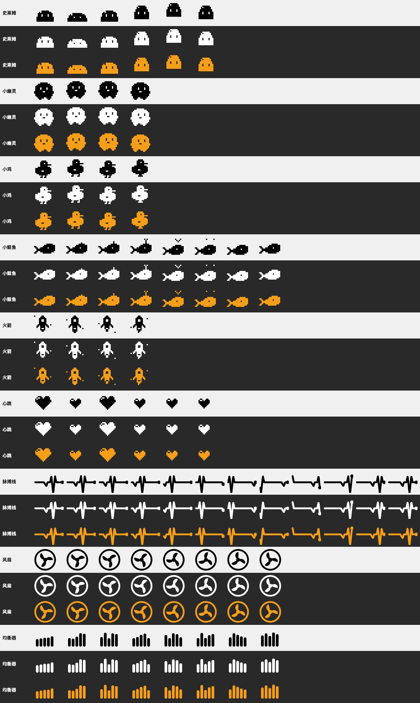

# MacPulse

A native macOS menu bar app: system monitor, disk analyzer and cleaner, written in SwiftUI.

原生 macOS 菜单栏工具：系统监控 + 磁盘空间分析 + 安全清理。



## 功能 Features

- **菜单栏动画图标**：史莱姆、小幽灵、小鸡、小鲸鱼、火箭、心跳、脉搏线、风扇、均衡器。CPU 越忙动画越快，可选按负载变色。
- **自己勾选显示内容**：CPU、CPU 走势图、内存、磁盘剩余、网速、温度、GPU、电池。
- **三种弹出面板**：紧凑列表 / 大数字卡片 / 大图表。
- **概览**：实时曲线、每个核心的负载（超大核 / 性能核 / 能效核）、24 小时历史、内存构成。
- **磁盘**：用方块图（treemap）逐层查看空间占用，右键在 Finder 中显示或移到废纸篓。
- **项目**：自动识别开发项目，区分源码 / Git 历史 / 依赖和构建产物；`dist`、`build` 只有在 `.gitignore` 里才算可安全删除。
- **进程**：按应用汇总（把同一个应用的多个子进程合并成一行），可以退出或强制退出。
- **清理**：开发缓存（npm / pip / Go / Cargo …）、项目产物、应用缓存、日志、下载里的旧文件、大文件。默认移到废纸篓；只动用户目录，受保护目录和白名单永远跳过。
- **提醒**：磁盘不足、内存压力紧张、CPU 持续高负载、每周可清理空间提示。
- **开机自启**，不联网，不收集任何数据。

Menu bar icons that animate faster as CPU load rises, user-selectable metrics, three popover layouts, a 24-hour history, a treemap disk explorer, per-project dependency/build-artifact sizes, per-app process grouping, and a cleaner that moves things to the Trash by default and never touches anything outside your home folder. No network access, no telemetry.

## 安装 Install

需要 macOS 14+ 和 Command Line Tools（不需要完整的 Xcode）：

Requires macOS 14+ and the Xcode Command Line Tools (full Xcode is not required):

```bash
git clone https://github.com/zephyrusguooo028/MacPulse.git
cd MacPulse
./scripts/install.sh   # builds, copies to /Applications and launches
```

只想构建不想安装：`./scripts/build.sh`，产物在 `build/MacPulse.app`。

The app is ad-hoc signed. Some folders (Mail, Messages, Trash) need **Full Disk Access** to be measured; Settings has a shortcut to grant it.

## 开发 Development

```bash
swift build
.build/debug/MacPulse --selftest                 # print every reading and scan result, no UI
.build/debug/MacPulse --icon-sheet icons.png     # render all icon frames
.build/debug/MacPulse --snapshot shots/          # open every page and save screenshots
```

Notes:

- On recent SDKs `@State` is a macro whose plugin ships only with full Xcode, so the views use a tiny `@Local` wrapper (`Views/Components.swift`) to build with the Command Line Tools alone.
- The menu bar item is driven through AppKit (`StatusItemController`) with cached bitmap frames; this keeps the animation cheap.
- CPU temperature comes from a private IOHID API resolved at runtime and is best effort.

## 结构 Layout

```
Sources/MacPulse/
  App/        entry point, settings, status item, alerts, diagnostics
  Metrics/    CPU, memory, disk, network, GPU, battery, temperature, processes, history
  Disk/       disk tree scanner, project scanner
  Cleanup/    cleanup candidates and the safe delete/trash executor
  Views/      SwiftUI pages, popovers, menu bar icons
scripts/      build.sh, install.sh, Info.plist, icon generator
```

## License

MIT
